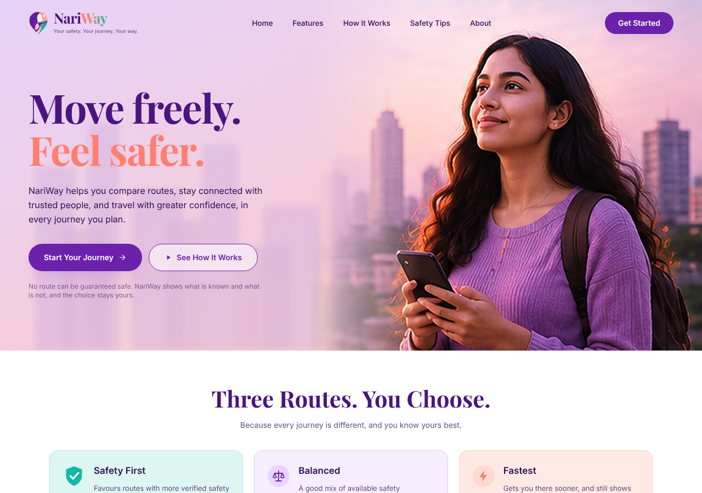
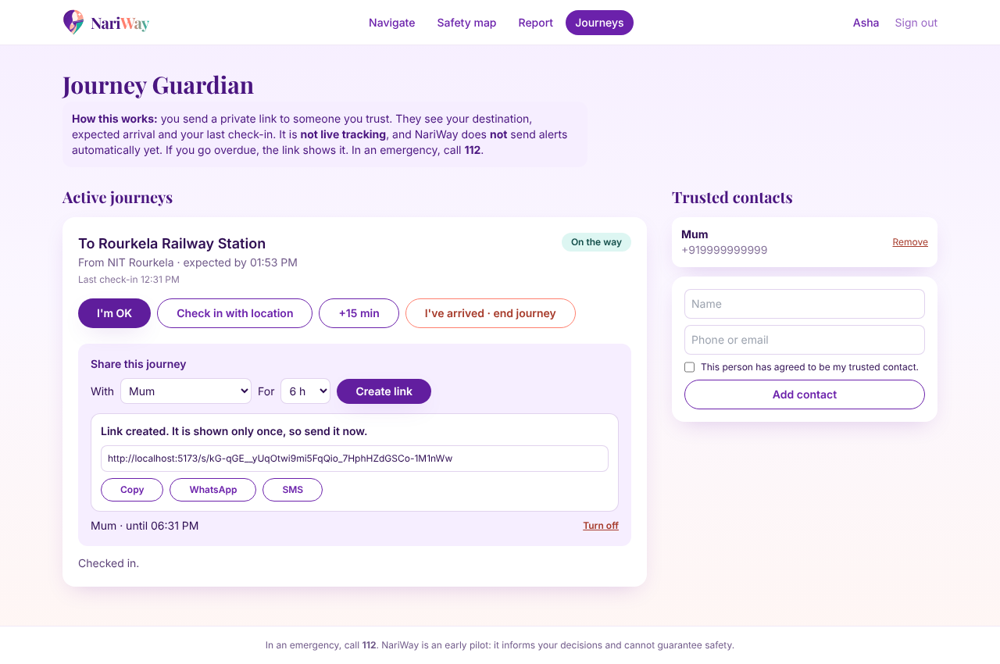
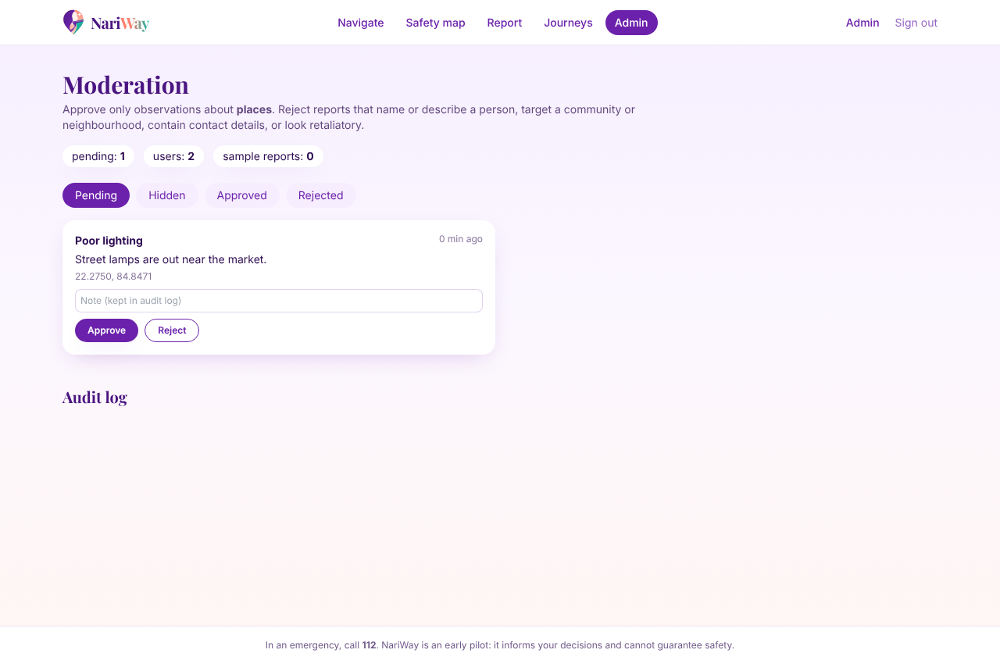

# NariWay

Safety-first navigation for women in India. NariWay generates several route options between two points, scores each one from the evidence that is actually available, and shows the reasoning so the traveller decides. It has a FastAPI backend, a React frontend, moderated community reports, and an opt-in Journey Guardian for sharing a trip with someone you trust.

No route can be guaranteed safe. NariWay informs a decision; it does not make one.



## Problem

The fastest route is often not the one a woman would choose at night. It may run through an unlit stretch or an isolated lane. Local knowledge is scattered across personal experience and group chats, and a plain "safety score" with no explanation creates false confidence, which is worse than no score.

NariWay is built around three rules:

1. Show the evidence behind every recommendation, with its coverage and age.
2. Treat missing data as unknown, never as safe. A street nobody has reported on is not a safe street.
3. Keep the traveller in control. Three modes (Safest, Balanced, Fastest) are shown side by side.

## Features

- Three route modes compared on one map, with time, distance, confidence label and the reasons for each pick
- Rules-based scoring that keeps risk and uncertainty separate, with report decay by category
- A guard against detours: a much slower route is never offered as the "safer" pick
- Community reports with a place-only policy: phone numbers, vehicle plates, emails and links are rejected
- Moderation queue, audit log, duplicate detection, daily limits, flagging and automatic hiding after three flags
- Safety map of approved, unexpired reports
- Journey Guardian: trusted contacts (consent required), check-ins, ETA extension, expiring and revocable share links
- Contact view at `/s/<token>` showing first name, destination, state and last check-in only
- Account deletion that erases journeys, contacts and share links, and anonymises reports
- Demo routing and sample data that are always labelled as sample data

### Limitations

- Journey Guardian is a shared-link check-in, not live tracking. NariWay does not send SMS, WhatsApp or push alerts for a missed arrival. The contact sees "Overdue" when they open the link.
- There is no SOS button. The emergency number 112 is shown as static text.
- Routes and safety indicators are synthetic until a routing server and real data sources are configured.
- OpenStreetMap is map data, not a safety database. Lighting and opening-hours coverage varies by city and must be audited before relying on it.

## Architecture

```
React + TypeScript (Vite, Tailwind, Leaflet)
        |  /api/v1  (JSON, JWT bearer)
FastAPI
  |-- routing    demo provider | OSRM client -> candidate routes
  |-- safety     evidence -> risk, uncertainty, coverage -> cost -> ranking
  |-- reports    policy checks, moderation, route matching
  |-- trips      contacts, journeys, hashed share tokens
  |
SQLAlchemy -> SQLite (dev) | PostgreSQL + PostGIS (pilot)
```

```
nariway/
  backend/
    app/
      api/            auth, routes, places, safety, admin, trips
      core/           config, security (bcrypt, JWT, token hashing), rate limiter
      models/         users, reports, flags, audit, contacts, trips, shares
      schemas/        request and response models
      services/
        routing/      demo provider, OSRM client
        safety/       scoring.py, geometry.py
        reports/      policy.py, near.py
      seed.py         labelled sample reports
    tests/
  frontend/
    src/
      pages/          Landing, Navigate, SafetyMap, Report, Journeys, Shared, Settings, Admin, Account
      components/     AppShell, Hero, route cards, brand components
      hooks/          useAuth, useMap
      services/       typed API client
  docs/               requirements, architecture, API, safety and privacy, screenshots
  Makefile
```

## Route scoring

Each candidate route gets a cost, and lower is better:

```
C(r) = w_t * T(r) + w_d * D(r) + w_r * R(r) + w_u * U(r)
```

- `T`, `D`: extra time and distance relative to the best candidate
- `R`: concern in [0, 1] from indicators (lighting, road type, open places) weighted by how much of the route each covers, plus nearby reports
- `U`: uncertainty, `1 - evidence coverage`

| Preference | time | distance | risk | uncertainty |
|---|---|---|---|---|
| Safest | 0.12 | 0.08 | 0.45 | 0.35 |
| Balanced | 0.35 | 0.15 | 0.30 | 0.20 |
| Fastest | 0.75 | 0.20 | 0.04 | 0.01 |

Rules that are covered by tests:

- If no evidence exists, `risk` is `null` and the route is labelled low confidence. It is never rewarded for silence.
- Reports decay with a half-life per category (for example 30 days for harassment, 90 for poor lighting) and only count within 150 m of the route.
- A route slower than 1.6x the fastest candidate is excluded from Safest and Balanced picks.

These numbers are a transparent decision aid, not a probability of harm.

## Community reports

A report is a place observation with a fixed category, up to 280 characters, a location and a time within the last 30 days. Lifecycle:

```
submitted -> pending -> approved -> (expired after 90 days)
                 |          |
                 |          +-> hidden (3 flags) -> moderator decides
                 +-> rejected
```

Only approved, unexpired reports are public or used in scoring. Public responses never include who submitted a report. Moderator decisions are written to an audit log.

## Journey Guardian

1. Start a journey from a chosen route. The expected arrival is the route time plus a margin.
2. Create a share link, optionally for a saved contact. The link contains a 256-bit random token, shown once.
3. Only the SHA-256 hash of the token is stored. Links expire, can be turned off, and die when the journey ends.
4. The traveller checks in, optionally with location. The contact sees the last check-in, not live position.
5. Ending the journey revokes every link and erases the stored location.



## API

Base path `/api/v1`. Full table in [docs/api-specification.md](docs/api-specification.md).

```http
POST /api/v1/routes/alternatives
{ "origin": {"lat": 22.2536, "lng": 84.9006},
  "destination": {"lat": 22.2290, "lng": 84.8640},
  "mode": "walk" }
```

```json
{
  "is_demo": true,
  "routing_source": "demo",
  "routes": [ { "id": "fast", "duration_s": 3600, "distance_m": 4680, "geometry": [ ... ] } ],
  "result": {
    "model_version": "rules-v0.2",
    "recommended": { "safety_first": "safe", "balanced": "balanced", "fastest": "fast" },
    "assessments": [
      { "route_id": "safe", "risk": 0.15, "uncertainty": 0.4, "confidence_label": "medium",
        "labels": ["safety_first"], "reasons": ["72 min, 5.4 km"], "hazards": [], "indicators": [ ... ] }
    ],
    "disclaimer": "Assessments reflect available evidence only. No route can be guaranteed safe."
  }
}
```

Errors use standard status codes with a plain-language `detail`: `422` invalid input (bad coordinates, personal details in a report), `401` and `403` for authentication and permission, `404` for anything not yours or not active (share links return the same `404` for invalid, revoked and expired), `409` duplicates, `429` rate limits, `503` when the routing service is down. Health check: `GET /api/v1/health`.

## Frontend

Pages: `/` home, `/navigate`, `/safety-map`, `/report`, `/journeys`, `/settings`, `/account`, `/admin`, and `/s/:token` for a contact. Comparing routes needs no account. Reports and journeys do.



## Complexity

Let `n` be candidate routes (at most 8), `p` points per route, `m` approved reports in the route's bounding box, and `k` stored reports.

| Operation | Time | Space |
|---|---|---|
| Score and rank routes | O(n) after evidence is gathered | O(n) |
| Match reports to routes | O(n * m * p) | O(m) |
| Drop near-duplicate alternatives | O(n^2 * p^2) | O(p) |
| Reports in a map view | O(log k) with the lat/lng index, plus output size | O(output) |
| Share link lookup | O(1) by indexed token hash | O(1) |

At pilot scale these are small. The first change at larger scale is moving report matching into PostGIS.

## Installation

You need Node 18+, Git, and either `uv` (recommended) or Python 3.11+.

```bash
git clone https://github.com/adyasha-official/nariway.git
cd nariway
make setup
```

Without `make`:

```bash
cd backend && uv venv --python 3.12 && source .venv/bin/activate && uv pip install -e ".[dev]"
cd ../frontend && npm install
```

Configuration lives in `backend/.env`. See `.env.example`. Outside development, `JWT_SECRET` is required and the server will not start without it.

## Usage

```bash
make backend      # http://localhost:8000
make frontend     # http://localhost:5173
make seed         # optional: labelled sample reports
```

To use the moderation page, register with an email listed in `ADMIN_EMAILS`, for example `ADMIN_EMAILS='["you@example.com"]' make backend`.

To use real routes, point `ROUTING_PROVIDER_URL` at a self-hosted OSRM server. The public demo servers are not for production use.

## Testing

```bash
make test
```

The backend suite (31 tests) covers scoring rules, unknown-is-not-safe, detour limits, report decay, authentication and rate limits, personal-detail rejection, duplicates, moderation, flag auto-hide, expiry, share-link lifecycle, cross-user access, token guessing, overdue state and account deletion. The frontend build runs the TypeScript check.

## Future improvements

- Notifications for missed arrivals (SMS or WhatsApp), tested end to end before it is described as a feature
- PostGIS spatial queries and Alembic migrations
- A data audit of lighting, road type and opening hours for the pilot city, and import of reliable sources
- Route diversity work on a real road graph, since alternatives from OSRM are often near-identical
- Time-of-day aware evidence
- Field validation: walk selected routes at different hours and compare with the app's assessment
- Privacy policy written against the DPDP Act, 2023
- Hindi and Odia, a PWA install, and accessibility audit
- Deployment with HTTPS, backups and error monitoring
